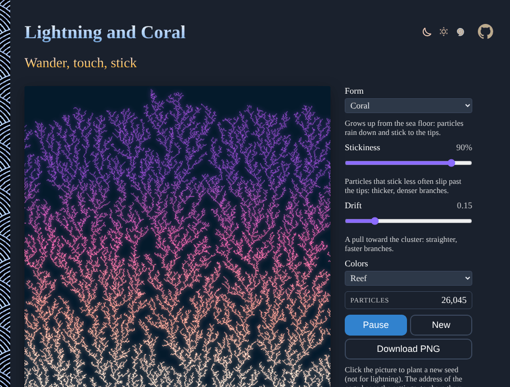

# Lightning-and-Coral

Particles wander at random and stick to a growing cluster, and coral, frost, crystals and roots appear. Lightning steps down from the cloud where the electric field is strongest, until it strikes the ground. Diffusion-limited aggregation and the dielectric breakdown model, live in the browser. No sign-up, no libraries.

**[▶ Grow some coral](https://evoluteur.github.io/lightning-and-coral/)**

## Features

| Control | What it does |
| ------- | ------------ |
| **Form** | Coral, Lightning, Frost, Six-fold crystal, or Roots. |
| **Stickiness** | The chance a particle sticks on contact: less sticky, thicker branches. |
| **Drift** | A pull toward the cluster: straighter, faster branches. |
| **Focus** (lightning) | How strongly the field picks the next step: low, a bushy discharge; high, a single bolt. |
| **Colors** | Storm, Reef, Frost, Earth, Ink on paper, Gold. |
| **Pause, New** | Stop the growth, or grow another one. |
| **Download PNG** | The picture. |

Click the picture to plant a new seed (not for lightning). Each picture comes from a seed kept in the address of the page, so the same link grows the same picture.

## How it is built

- **Coral, frost, crystal and roots**: diffusion-limited aggregation (Witten and Sander, 1981). A particle is released just beyond the cluster and walks at random, with big jumps when it is far away and single steps near the cluster, until it touches it and sticks. Tips stick out, so they catch more particles, so they stick out more: branches on branches. The six-fold crystal mirrors each particle twelve ways around the center.
- **Lightning**: the dielectric breakdown model (Niemeyer, Pietronero and Wiesmann, 1984). The electric potential is 0 on the cloud and the bolt, 1 on the ground, and solved in between by successive over-relaxation. The bolt steps to a neighboring cell with a probability of the potential there to the power of *Focus*. When a branch touches the ground, the path back to the cloud lights up: the return stroke.
- A seeded random generator makes each picture reproducible from its seed.

Plain HTML, CSS and JavaScript, with no dependencies and no build step:

| File | Content |
| ---- | ------- |
| [index.html](index.html) | the page and its controls |
| [js/dla.js](js/dla.js) | the walkers, the lightning and the drawing |
| [css/dla.css](css/dla.css) | the styles of the page |
| [css/themes](css/themes) | the three color themes |

To run it locally, just open `index.html` in a browser. The three color themes (dark, light and blue) are shared with my other projects (copied from [omg-themes](https://github.com/evoluteur/omg-themes)).

## A little history

Thomas Witten and Leonard Sander, *Diffusion-Limited Aggregation, a Kinetic Critical Phenomenon* (Physical Review Letters, 1981). L. Niemeyer, L. Pietronero and H. J. Wiesmann, *Fractal Dimension of Dielectric Breakdown* (Physical Review Letters, 1984).

## Related projects

- [Snowflake Grower](https://evoluteur.github.io/snowflake-grower/) ([code](https://github.com/evoluteur/snowflake-grower))
- [Slime Mold](https://evoluteur.github.io/slime-mold/) ([code](https://github.com/evoluteur/slime-mold))
- [Infinite Coastlines](https://evoluteur.github.io/infinite-coastlines/) ([code](https://github.com/evoluteur/infinite-coastlines))

For more patterns grown from a few rules, see [Generative Art](https://evoluteur.github.io/generative-art.html).

## License

Lightning and Coral is open source under the [MIT license](LICENSE).

Had fun with the app? [Buy me a coffee by becoming a sponsor](https://github.com/sponsors/evoluteur).

(c) 2026 [Olivier Giulieri](https://evoluteur.github.io/)
